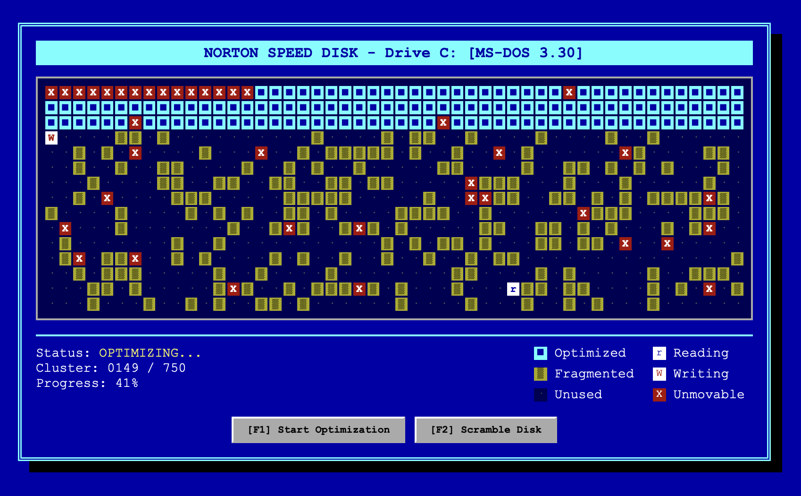

## Why Norton Utilities Never Left My Disk Folder - Speed Disk Edition

This little project started with a YouTube video.

Recently, I watched a video about what happened to Norton Utilities after the days when it was still owned by Peter Norton's company. One memory led to another, and before long I found myself building a browser-based simulator inspired by Norton Speed Disk.

That got me thinking about the role Norton Utilities played in my own career.

When I started as a PC repair technician in the mid-1990s, there were a handful of floppy disks that never left my disk folder. Norton Utilities was one of them.

Back then, a disk folder was your toolbox. Long before USB drives, cloud storage and built-in recovery tools, those floppy disks were what you relied on when a customer's machine needed rescuing.

The utility I used most was Norton Disk Doctor. Whenever a machine showed signs of disk corruption or strange filesystem behaviour, it was often the first tool I reached for. It wasn't perfect, but it solved enough problems that I quickly learned to trust it.

I also made regular use of Unerase. Before recycle bins, cloud backups and version history, deleting an important file could be a genuine disaster. Watching Unerase recover a file that someone thought was lost forever often felt like magic.

The tool that fascinated me most, however, was Disk Editor. I didn't use it nearly as often, but I spent plenty of time exploring it. It gave direct access to sectors and filesystem structures, making it incredibly powerful, but also a little intimidating. One wrong change could make a bad situation much worse. It was a tool that demanded respect.

Of course, the utility most people remember is Speed Disk. For a task as mundane as defragmenting a hard drive, it somehow made the process fascinating to watch. Seeing blocks move around the screen as files were reorganised gave you a sense that something meaningful was happening behind the scenes.

In fact, that's exactly why I created the simulator above. Modern SSDs don't need the sort of defragmentation that Speed Disk was designed for, but there's something about that visualisation that has stuck with me for more than thirty years.

Looking back, Norton Utilities wasn't just software. It was part of how I learned the trade. It helped me solve problems, recover files, and better understand how computers actually worked.

And apparently, all it took was one YouTube video and a Speed Disk simulator to bring those memories flooding back.

<a href="https://othelovieira.com/speeddisk/">Link to Speed Disk Simulator</a>

This post was written with ❤️ and ☕️

